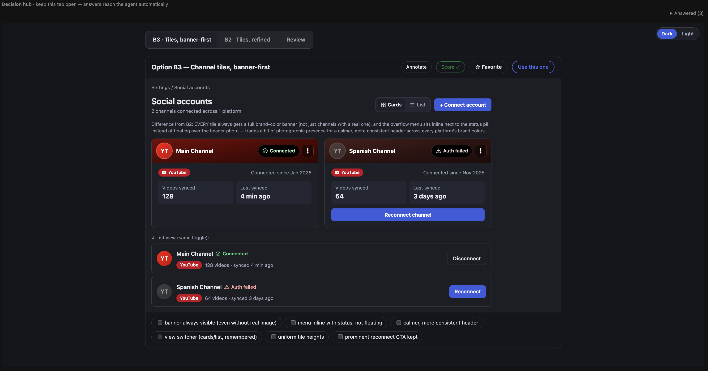
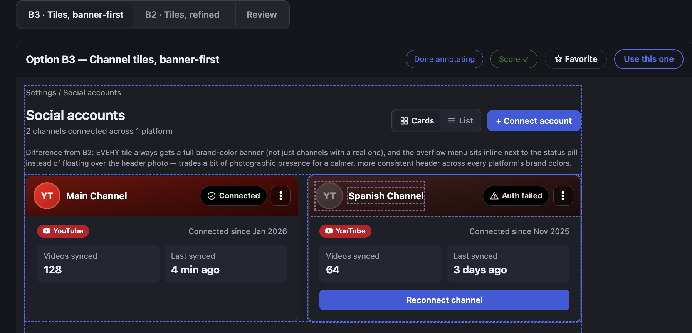
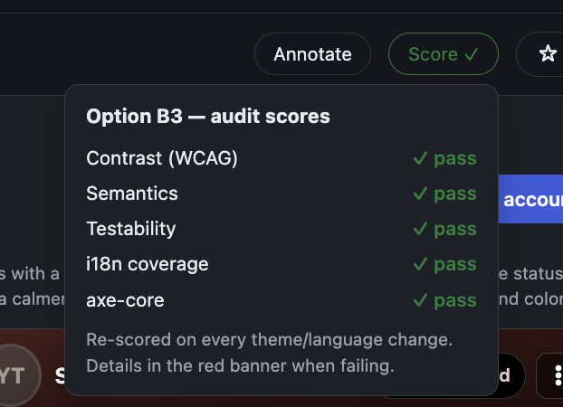

# development-skills

Plugins that teach coding agents to work in [Herdr](https://herdr.dev) and to design UIs, as a marketplace for [Claude Code](https://docs.claude.com/en/docs/claude-code/plugin-marketplaces) and Codex, with OpenCode skill-directory support.

## Plugins

| Plugin | What it is | Needs |
| --- | --- | --- |
| [`herdr`](plugins/herdr/README.md) | Worktrees, agents, prompts, listening and status in Herdr | `herdr`, `bash`, `jq`, `git` |
| [`herdr-graph-engineering`](plugins/herdr-graph-engineering/README.md) | One orchestrator chat; each idea is a lane running a small graph to its definition of done | `herdr` plugin, `jq`, `yq`, `git` |
| [`herdr-simple-orchestrate`](plugins/herdr-simple-orchestrate/README.md) | Deprecated: the old orchestrator role and multi-PR code review | `herdr` plugin |
| [`ui-design`](plugins/ui-design/README.md) | Mock UI options and let the human decide | `bash`, `jq`, `git`, `socat` |

### Archived plugins

`spec-workflow`, `remote-compute`, `peer-review`, `scaffold-project` and `herdr-development-skills` are **archived**. They are no longer in this marketplace. They have their own marketplace in [`archived/`](archived/README.md), installed from a clone:

```bash
git clone https://github.com/Zugruul/development-skills.git
claude plugin marketplace add ./development-skills/archived
claude plugin install spec-workflow@development-skills-archived
```

**Had one of them installed from here?** This is a breaking change: once your copy of this marketplace updates, Claude Code can no longer load it. Follow [Moving an existing install](archived/README.md#moving-an-existing-install).

## Install

### Claude Code

```bash
claude plugin marketplace add Zugruul/development-skills
claude plugin install herdr@development-skills
```

For another plugin, substitute its name. Or per repository (shared with everyone opening it) via `.claude/settings.json`:

```json
{
    "extraKnownMarketplaces": {
        "development-skills": {
            "source": { "source": "github", "repo": "Zugruul/development-skills" }
        }
    },
    "enabledPlugins": { "herdr@development-skills": true }
}
```

### Codex

```bash
codex plugin marketplace add Zugruul/development-skills
```

Restart the ChatGPT desktop app, open the Plugins Directory, select **Development Skills**, and install the plugin or plugins you need. Start a new chat after installation so Codex loads their skills. For a local checkout, run `codex plugin marketplace add .` from the repository root instead.

Before updating, confirm `codex plugin marketplace list` includes
`development-skills` in the same runtime/profile as the desktop's active skill
path. Then run `codex plugin marketplace upgrade development-skills`, verify
the installed files changed, and restart the desktop/start a new chat. An empty
CLI listing does not prove the desktop has no plugin; resolve discrepancies
before adding or reinstalling anything. Marketplace installs keep the packaged
skills together with their scripts, references, and templates.
`install-skills.sh codex` is an alternative for linking raw skill folders into
a project's `.agents/skills/`; use one installation method per skill to avoid duplicates.

### Skill directories (all three hosts)

Every skill is host-portable (frontmatter `name` matching its directory, a `description`, `$ARGUMENTS` for arguments). Beyond the marketplaces, `install-skills.sh` symlinks the skills of the maintained plugins into any project's per-client skill directories:

```bash
./install-skills.sh all        # or: claude | opencode | codex
```

| Host | Project skill directory | Marketplace alternative |
|-|-|-|
| Claude Code | `.claude/skills/` | `/plugin marketplace add` on `.claude-plugin/marketplace.json` |
| OpenCode | `.opencode/skills/` | — (skills dirs are the mechanism; OpenCode also auto-loads `~/.claude/skills` and `~/.agents/skills`) |
| Codex | `.agents/skills/` | `.agents/plugins/marketplace.json` |

Symlinks, never copies — canonical edits are live immediately. Use either a marketplace or the skills-dir install per host, not both (duplicate entries). Set `DEV_SKILLS_PROJECT_ROOT` to target another project. Verified live: `opencode debug skill` lists every installed skill from a target project.

## Update

Refresh the marketplace listing, then update the installed plugin you need:

```bash
claude plugin marketplace update development-skills
claude plugin update herdr@development-skills
```

In Claude Code's `/plugin` Installed view, **Update now** updates one plugin. Verify the installed copy, then reload plugins or start a new session. In Codex, see the note above.

## Plugin details

### herdr

Skills that teach an agent to use [Herdr](https://herdr.dev), the terminal
workspace manager for AI coding agents: start worktrees and agents, prompt them
without duplicates, listen to their work, and see what is running. It only
teaches Herdr: no workflow of its own and no knowledge of other plugins. Thin
over the `herdr` CLI, with three bash scripts for what the CLI cannot do in one
call. See [herdr](plugins/herdr/README.md).

| Skill | Purpose |
|---|---|
| `worktree` | Start a Herdr worktree after read-only checks and the user's approval, optionally with agents on it, each with a first prompt |
| `agent` | Start an agent in an existing pane, retrying while the pane is busy, then send its first prompt |
| `prompt` | Send a follow-up prompt with `herdr agent prompt --wait`, or relay the user's answer to a blocked agent; never submits the same text twice |
| `listen` | Report what agents are doing, wait until one blocks or finishes, and surface its question, asking which agent or tab when unclear |
| `status` | Read-only lists of live agents and the repository's open worktrees |

```bash
claude plugin install herdr@development-skills
```

### herdr-graph-engineering

Graph engineering on Herdr, kept thin. One orchestrator chat takes your ideas;
each becomes a lane (its own worktree) running a small graph from a pattern
(`solo`: implementer then a tests gate with bounded retries; `pair`: the same
plus a second-opinion reviewer; `fast`: urgent fixes, on request, the draft pull
request opens before the tests gate; `investigate`: a read-only report). Scripts decide what is ready and record results in one lane
file per lane; the orchestrator checks evidence, opens a draft pull request when
a lane is done, and asks you only when a lane needs you. **Requires the herdr
plugin**, `jq`, `yq` and `git`. See
[herdr-graph-engineering](plugins/herdr-graph-engineering/README.md).

| Skill | Purpose |
|---|---|
| `orchestrate` | The one chat: route ideas into lanes and run them until their definition of done |
| `display` | Opens or closes the Herdr graph panel next to the orchestrator (refresh, interval toggle, jump, answer), or prints the picture as text |
| `concurrency` | Guidance for running many lanes at once; no limit by default, a cap only when you ask |

```bash
claude plugin install herdr-graph-engineering@development-skills
```

### herdr-simple-orchestrate (deprecated)

The old way of orchestrating agents in Herdr, moved out of `herdr`: the
orchestrator role and an orchestrated code review of related pull requests.
Kept so existing setups keep working. **Requires the herdr plugin.** See
[herdr-simple-orchestrate](plugins/herdr-simple-orchestrate/README.md).

| Skill | Purpose |
|---|---|
| `orchestrate` | Take the orchestrator role, load the herdr skills, and report on demand (`NEEDS YOU`, `WORKING`, `DONE`) |
| `orchestrate-code-reviews` | Orchestrate a code review of a group of related pull requests: one reviewer agent per worktree plus a cross-PR checker draft, one agent per pull request posts a single COMMENT review, then the orchestrator puts a verified summary into that review's body |

```bash
claude plugin install herdr-simple-orchestrate@development-skills
```

### ui-design





Mock a UI before it is built and let the human decide. The agent mocks 2–4
genuinely different options at the target's real size and serves them on a
local decision hub; the human picks, favorites, ticks aspects or annotates
elements, and the answer comes straight back. Every page passes an
accessibility audit in both themes (WCAG contrast, real semantics, target size,
input purpose, axe-core), carries a `data-testid` on every control, and is
translated when asked. Standalone: no workflow, tracker or other plugin; other
skills call it by name. Needs `bash`, `jq`, `git` and `socat`. See
[ui-design](plugins/ui-design/README.md).

| Skill | Purpose |
|---|---|
| `ui-mode` | Show or toggle Iterative UI mode (the human decides UIs, or the agent does) |
| `ui-options` | Mock the options, gate them, ask on the hub, iterate until the human commits, record the pick |

```bash
claude plugin install ui-design@development-skills
```

## Working on this repository

```bash
bash plugins/herdr/tests/run-tests.sh                    # hermetic: runs against a stub herdr, no Herdr install needed
bash plugins/herdr-graph-engineering/tests/run-tests.sh
bash plugins/herdr-simple-orchestrate/tests/run-tests.sh
bash plugins/ui-design/tests/run-tests.sh                # hermetic: stub socat, the hub handler driven on stdin
bash .github/scripts/check-marketplaces.sh               # both marketplaces, root and archived
```

To try your changes, point the marketplace at your clone instead. With a `directory` source, skill edits reach new sessions immediately (no version bump):

```bash
claude plugin marketplace remove development-skills
claude plugin marketplace add /path/to/development-skills
```

Removing a marketplace uninstalls the plugins installed from it, so reinstall the ones you need.

The rules for agents and contributors are in [`AGENTS.md`](AGENTS.md), for both Claude Code and Codex; [`CLAUDE.md`](CLAUDE.md) points to it. [`CHANGELOG.md`](CHANGELOG.md) is generated on `main`.
