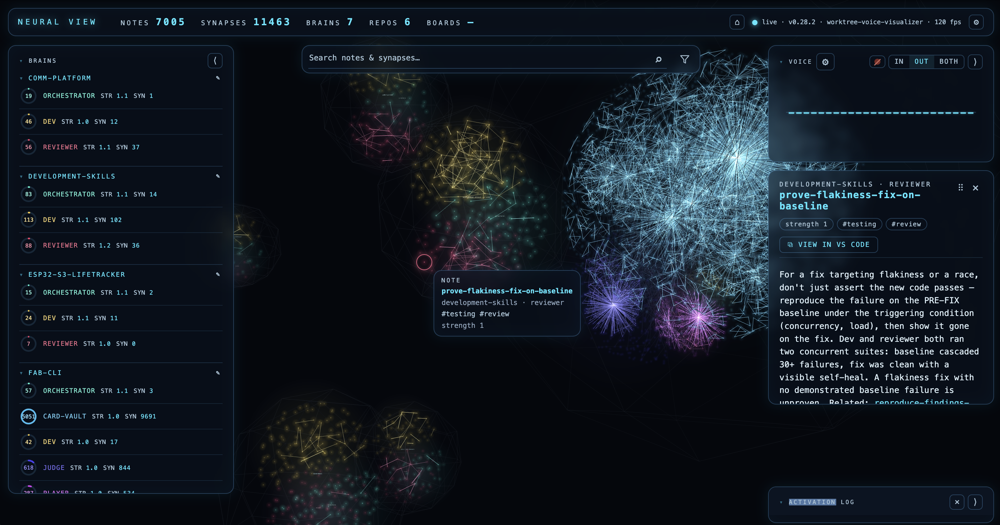
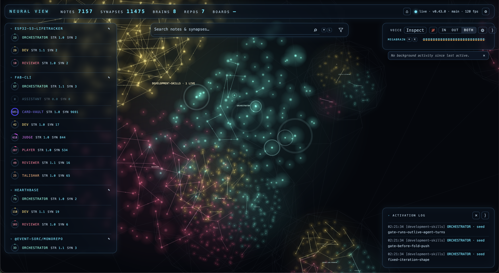
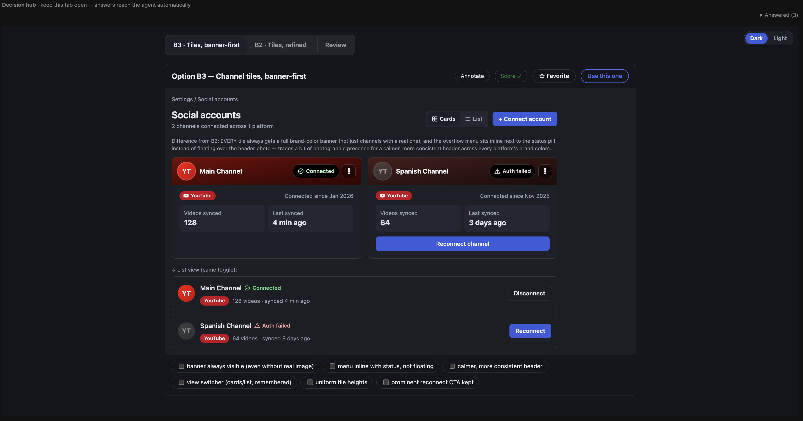
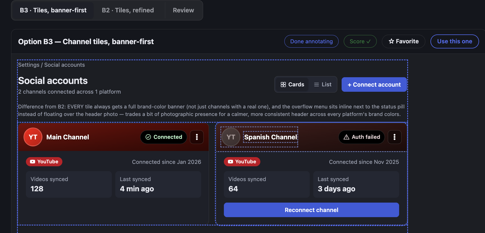
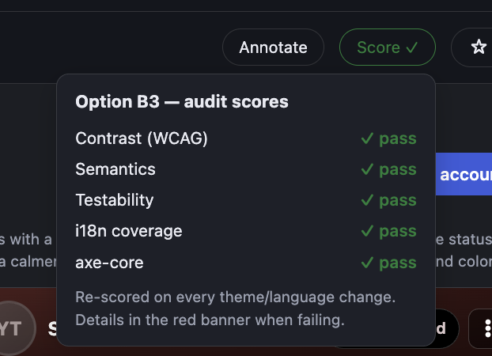

# development-skills

A development-workflow marketplace for [Claude Code](https://docs.claude.com/en/docs/claude-code/plugin-marketplaces) and Codex, with OpenCode skill-directory support.

## Install

### All three hosts (Claude Code, Codex, OpenCode)

Every skill is host-portable (frontmatter `name` matching its directory, a `description`, `$ARGUMENTS` for arguments). Beyond the marketplaces, `install-skills.sh` symlinks the canonical skills into any project's per-client skill directories:

```bash
./install-skills.sh all        # or: claude | opencode | codex
```

| Host | Project skill directory | Marketplace alternative |
|-|-|-|
| Claude Code | `.claude/skills/` | `/plugin marketplace add` on `.claude-plugin/marketplace.json` |
| OpenCode | `.opencode/skills/` | — (skills dirs are the mechanism; OpenCode also auto-loads `~/.claude/skills` and `~/.agents/skills`) |
| Codex | `.agents/skills/` | `.agents/plugins/marketplace.json` |

Symlinks, never copies — canonical edits are live immediately. Use either a marketplace or the skills-dir install per host, not both (duplicate entries). Set `DEV_SKILLS_PROJECT_ROOT` to target another project. Verified live: `opencode debug skill` lists every installed skill from a target project.

```bash
claude plugin marketplace add Zugruul/development-skills
claude plugin install spec-workflow@development-skills
```

Or per-repo (shared with everyone opening the repo) via `.claude/settings.json`:

```json
{
    "extraKnownMarketplaces": {
        "development-skills": {
            "source": { "source": "github", "repo": "Zugruul/development-skills" }
        }
    },
    "enabledPlugins": { "spec-workflow@development-skills": true }
}
```

## Tooling

### Neural View



Visualization of "brains" that help guide development and knowledge base over each project. With help of RAG in addition to semantic search we are able to probe it for information.

### Live activations — watch the memories fire



When an agent recalls a lesson, you see it happen. Every `brain.sh recall` an
orchestrator runs — while briefing a dev agent, reviewing a diff, or answering
a question — emits activation events, and the neural view renders them the
moment they occur:

- **Expanding rings** pulse around the exact notes being accessed, right where
  they sit in their repo's cluster — in the screenshot, a live
  `development-skills` session is seeding three orchestrator memories and the
  ripples radiate out from each one.
- **The activation log** (bottom right) narrates the same events as text:
  timestamp, repo, role, event kind, and the note's slug — so a glowing neuron
  is never anonymous.
- **Spreading activation is visible too**: after the seeded notes light up,
  energy flows along their synapses to related notes (the `hop` events), which
  is literally the recall ranking algorithm drawing itself.
- **Live session markers** (`· 1 LIVE` next to a repo name) show which brains
  currently have an agent thinking against them.

Nothing is replayed or simulated — the page tails each brain's
`.activation.jsonl` feed, so what you're watching is the actual memory traffic
of agents working, as it happens. Leave it on a second monitor and you can
tell at a glance *what the loop is thinking about* without reading a single
transcript.

### UI Mode





Allows quick iterations over UI before its implementation. With i18n and theming support. Also supports a11y checks to ensure that you are delivering the best accessibility and testability possible as well. 

### Remote compute

Use another computer as compute. Register a machine once, then send work to it
from wherever you are working — typically driving a GPU box from a laptop.

- **Key-based SSH only.** Never a password prompt, never a stored secret.
- **Jobs run detached** and survive your session ending; state lives in files on
  the machine, so status and logs are recoverable afterwards.
- **Tools plug in as data.** Supporting a new tool (image generation, model
  training) means adding a small bundle folder, never changing the software.
- **Validated recipes.** Values are validated and quoted once; workflows are
  pre-authored. Bundles execute trusted code with the SSH account's permissions,
  not inside a sandbox. Privileged setup steps are printed for the human.

A machine is registered once, told which environments and tools it has, and then
given named job recipes you run with different parameters. A terminal dashboard
on the machine shows what is queued, running, and finished.

The controller CLI help is `python3 plugins/remote-compute/scripts/remote-compute.py --help`.
It lists machine, job, and capability commands, including `capabilities list`,
`capabilities install <nickname> <bundle-name-or-directory>`, and
`capabilities installed [<nickname>]`. On a registered compute machine,
`remote-compute help` lists local and controller commands. Bare `caps` (also
`capabilities`) shows bundles on this machine. Install the combined CLI on
WSL/Linux/macOS with `python3 plugins/remote-compute/scripts/remote-compute.py install-cli`.
Existing local commands and legacy controller aliases remain supported.

Capabilities can come directly from GitHub, without changing this marketplace:

```bash
remote-compute capabilities install storm590x https://github.com/OWNER/REPO CAPABILITY --ref main
remote-compute capabilities install storm590x https://github.com/OWNER/REPO --all
remote-compute capabilities sync storm590x  # on another registered client, e.g. a MacBook
remote-compute doctor storm590x
```

The repository must contain `capability.yaml` bundles, not just arbitrary
workflow files. Install only trusted code; installs record the resolved commit.
Target-side admission coordinates clients sharing one SSH account, while stable
UUIDs keep machine identity independent of each client's nickname.

**→ Full guide: [docs/remote-compute.md](./docs/remote-compute.md)** — setup,
registering a machine, declaring jobs, running and watching work, sharing a
machine between projects, and adding support for a new tool.

## Compatibility audit

The [incremental compatibility matrix](docs/compatibility-matrix.md) audits the
four shipped remote-compute skills for Claude Code and Codex. It separates
source review and local tests from unverified live execution, names known
gaps, and documents WSL/Linux/macOS execution with a WSL bridge for Windows
Codex hosts. Native PowerShell is unsupported; this is not a marketplace-wide
parity claim or completion of CDX-042.

## Update

Refresh the marketplace listing, then update the installed plugin you need:

```bash
claude plugin marketplace update development-skills
claude plugin update remote-compute@development-skills
```

For another plugin, substitute its name. In Claude Code's `/plugin` Installed
view, **Update now** updates that plugin. Verify the installed copy, then reload
plugins or start a new session. See the [installed-update guide](docs/remote-compute-updates.md)
for source/profile checks, standalone and target updates, and custom-state recovery.

## Codex desktop install

All four plugins are available through the repository's Codex marketplace at `.agents/plugins/marketplace.json`. From a terminal with Codex CLI installed, add the marketplace:

```bash
codex plugin marketplace add Zugruul/development-skills
```

Restart the ChatGPT desktop app, open the Plugins Directory, select **Development Skills**, and install the plugin or plugins you need. Start a new chat after installation so Codex loads their skills. For a local checkout, run `codex plugin marketplace add .` from the repository root instead.

Before updating, confirm `codex plugin marketplace list` includes
`development-skills` in the same runtime/profile as the desktop's active skill
path. Then run `codex plugin marketplace upgrade development-skills`, verify
the installed files changed, and restart the desktop/start a new chat. An empty
CLI listing does not prove the desktop has no plugin; resolve discrepancies
before adding or reinstalling anything. Marketplace installs keep the packaged
skills together with their scripts, references, and templates.
`install-skills.sh codex` is an alternative for linking raw skill folders into
a project's `.agents/skills/`; use one installation method per skill to avoid duplicates.

Codex reads the repo's canonical agent instructions from [`AGENTS.md`](AGENTS.md); Claude Code reads [`CLAUDE.md`](CLAUDE.md), which points to the same file. Codex support is still being checked against the compatibility work in [`SPEC-CODEX-COMPAT.md`](SPEC-CODEX-COMPAT.md) and [`docs/BACKLOG-CODEX-COMPAT.md`](docs/BACKLOG-CODEX-COMPAT.md).

## Assistant observability (in progress)

The in-repo assistant (`SPEC-ASSISTANT.md`) records every turn as an event in a
per-repo, gitignored `.claude/assistant/traces.sqlite` (append-only, WAL mode).
Retention is pruned automatically by a single background writer thread, oldest
events first, configured per repo via `assistant.observability.traces.sqlite`
in `project.yaml`:

```yaml
assistant:
  observability:
    traces:
      sqlite:
        retainDays: 30   # delete events older than N days; 0 = unlimited
        maxMB: 500        # trim oldest events until the file is under N MB; 0 = unlimited
```

Both knobs default to `30`/`500` when omitted. Retention only ever touches
`traces.sqlite` — it never deletes the embeddings index, `session.jsonl`, or
any other local-state file. Full observability epic tracked in
[`docs/design/ast-E4.md`](docs/design/ast-E4.md).

Memory access is fully observable too — see
[Live activations](#live-activations--watch-the-memories-fire) under Tooling
for the real-time view of recalls lighting up the network.

## Testing

Task-start preflight validates the resolved project config and checks the managed
ignore block against the current manifest. A missing/stale block or inspection
failure prints `PREFLIGHT FAIL` with a repair command; skill callers stop on that
line even though the loader exits zero. Repair explicitly with
`bash plugins/spec-workflow/scripts/gitignore-sync.sh /path/to/repo/.gitignore`
(or the corresponding installed plugin script), then rerun preflight. Dry-run
uses the same comparison and cleans its own temporary files, even when TMPDIR
points inside the repo. See the [runtime path audit](docs/audits/runtime-paths-274.md)
for all-plugin coverage and caller-selected path exclusions.

Before switching branches or pulling, build-next also inspects the actual checkout
with `bash plugins/spec-workflow/scripts/checkout-preflight.sh [--root DIR]`.
The read-only command reports JSON `clean`/`dirty`/`uninspectable` (exit 0/1/2),
including staged, unstaged, untracked, conflicting and submodule changes even when
Git status preferences hide them. Ignored files stay ignored. Pass
`--checkout worktree` only for an already authorized worktree session: dirty work
then routes to a separate clean lane based on fetched remote main (local main
when no remote exists). An explicit main-only session pauses for a decision.
Existing edits, HEAD, index and stashes are preserved; nothing is auto-stashed or
committed. The advisory loader remains zero-exit and surfaces the routing decision.
This is a point-in-time check, not a lock against concurrent writers; a clean
linked worktree is checked independently of a dirty primary checkout. See the
[startup protocol](plugins/spec-workflow/skills/build-next/SKILL.md#dirty-checkout-isolation-285).

```bash
bash plugins/spec-workflow/tests/run-tests.sh    # hermetic: validator fixtures + preflight (CI runs this + shellcheck + manifest validation)
claude plugin eval plugins/spec-workflow         # skill evals (early access; needs API credits)
```

The evals exercise the skills on real models — including smaller ones (`--model sonnet`) —
to keep them simple-model-proof.

## Local development

To hack on the skills, point the marketplace at your clone instead — with a
`directory` source, skill edits reach new sessions immediately (no version bump):

```bash
claude plugin marketplace remove development-skills
claude plugin marketplace add /path/to/development-skills
```

## Plugins

### spec-workflow

The assistant's `remote-compute-control` skill provides restricted SSH access to
approved WSL targets, separate from the human remote-compute controller. Install
only its data with `python3 -I /absolute/plugin/scripts/assistant/remote_control.py
install --assistant-root /absolute/assistant-repo`, then provision dedicated keys
and explicitly enable it. Its installed manifest owns the host allowlist. Follow
the [setup, security and testing guide](docs/assistant-remote-control.md); local
checks do not prove live enforcement. Managed commands require committed audit intent,
sanitize persisted data, and retain task recovery IDs independently of trace retention.
The separate `comfyui-render` skill queues pinned API workflows through a dedicated
SSH tunnel, samples native WebSocket progress, and publishes images through the
existing artifact endpoint. See the [render deployment and recovery guide](docs/assistant-comfyui-render.md).

Spec-driven autonomous build workflow. A repo declares its boards, specs, epics, guards, gate command, delegation roster, and conventions in a **versioned YAML config** (`.neural-network/project.yaml`, schemaVersion 2 — schema in `plugins/spec-workflow/schemas/`, wired for editor hover/autocomplete via a `# yaml-language-server` modeline; needs PyYAML); the plugin's skills and scripts read that config through one shared loader, so the same workflow drives any project. A legacy `.neural-network/project.json` (schemaVersion 1) is still read and auto-converted (deprecated).

| Skill | Purpose |
|---|---|
| `craft-spec` | Assisted spec creation: interview → draft → review → backlog |
| `setup-project` | Bootstrap a repo: config, GitHub Project board, validation |
| `setup-assistant` | Scaffold a bare-brain assistant repo (marker, project.yaml assistant section, brain dirs, persona AGENTS.md, gitignores) and edit its settings |
| `remote-compute-control` | Install data-only assistant access to approved WSL targets: audited inventory, status, redacted bounded logs and cancellation through dedicated forced-command SSH keys |
| `comfyui-render` | Queue pinned ComfyUI image workflows over a dedicated SSH tunnel, recover owned requests, and publish audited artifacts |
| `seed-board` | Create issues + board items from a spec's backlog (idempotent) |
| `board` | All board reads/writes (single script, no hardcoded ids) |
| `next-task` | Prioritized + sequenced + guarded pick; reads human comments |
| `queue` | Read-only view of the upcoming build-next picks, priority-first, with blocked reasons |
| `find-task` | Ranked search of existing board issues by title/body similarity (dedup) |
| `create-inbound` | Search-first, dedup-gated capture of ad-hoc ideas/bugs/requests onto the board |
| `implement-task` | One task via TDD, delegated to a dev subagent with a what/how/why brief |
| `ui-options` | Iterative UI mode: human picks the UI from an options page (favorite + aspects) |
| `gate` | The project's single green-before-advance quality command |
| `build-next` | One full loop iteration — drive with `/loop /spec-workflow:build-next` |
| `brain` | Per-identity zettel memory: private brains, spreading-activation recall, retro mint/prune/graduate |
| `auto-merge` | Toggle autonomous PR review + merge (reviewer agent approves instead of a human) |
| `pr-review-model` | Show/set the model the autonomous PR reviewer runs on |
| `agent-identities` | Per-role commit attribution — each person's clone signs agent commits with their own plus-addressed email |
| `concurrency` | Show/set `methodology.maxInProgress` — sequential (default) vs N parallel implementation lanes |
| `checkpoint` | Pause/resume the loop via a local flag file |
| `handoff` | Session/pause handoff document |
| `dev-up` | Bring up the project's dev stack for QA |
| `neural-view` | Live JARVIS-style visualization of the identity brains — notes as neurons, recalls lighting up in real time |
| `feedback` | Structured per-iteration process feedback about the workflow itself (`methodology.feedback`); triaged into backlog/brain-note/graduate/upstream/ignore at retro time |
| `sync-project-configs` | Discover every anchored repo and bring its `.neural-network/project.yaml` up to the plugin's current config surface via versioned sync rules; dry-run by default |
| `changelog-generate` | Fully regenerates `CHANGELOG.md` from git history, versioned by `plugin.json`'s semver windows and grouped by conventional-commit type; idempotent, kept fresh on every push to `main` by a GitHub Action |

Humans steer the loop by commenting on task issues: `next-task`/`implement-task` read every comment before starting, fold accepted changes into the issue's acceptance criteria, and reply on the issue.

### remote-compute

Register remote machines (SSH, key-only) as user-level compute resources and
dispatch jobs/capability bundles to them. **Requires the spec-workflow
plugin** for project setup and the gitignored project.local.yaml overlay.
`run --role ROLE JOB [--root DIR]` and
`dispatch --role ROLE --workdir W --cmd C [--root DIR]` select enabled,
registered aliases in lexical order with an exact role match. The standalone
controller reads only compute, with local compute replacing the whole base value.
Nickname commands remain unrestricted by project availability and read no project.
Fallback is limited to pre-reservation busy/connectivity failures or explicit
target admission refusals; uncertain reservation or launch stops for inspection.
Full guide:
[docs/remote-compute.md](./docs/remote-compute.md).

The ComfyUI bundle also offers explicit, non-executing UI-save import:
`remote-compute run gpubox comfyui:import-workflow --job-id comfy-import-example --param workflow=/path/UI.json --param port=8188`.
It writes a new API artifact for later rendering. Only the documented
`core-txt2img-v1` workflow-v0.4 seven-core-class profile is supported, with fixed
seed control and exact graph/schema agreement; custom nodes, dynamic prompts,
filename substitutions and ambiguous graphs are refused. It does not support
all saved workflows or frontend versions. See the
[exact boundary, offline invocation and native-export fallback](docs/remote-compute.md#explicit-comfyui-ui-save-import).
Behavioral schema options are validated per input; transformed prompt escape
forms and reserved node IDs `nodes`/`links` are refused. Once published, an
artifact remains a success even if temporary-file cleanup emits a warning.

| Skill | Purpose |
|---|---|
| `remote-compute` | Register/probe machines, manage project availability, install bundles, and run or inspect work by explicit nickname or project role. |
| `compute-top` | Terminal dashboard, on the machine or over SSH, for what remote-compute work is running/finished there; opens logs, prunes history |

### peer-review

Get a source-labeled second opinion from OpenAI Codex or Anthropic Claude through
trusted local provider scripts. Review material can include repository context
beyond the diff; the user's CLI configuration owns authentication and transport.
Review flags constrain intended edits, not network isolation. There is no peer HTTP
dispatcher or endpoint allowlist; SSH-machine registration grants no peer HTTP
authority. See [peer-review](plugins/peer-review/README.md) for the disclosure and
provider configuration boundary.

| Skill | Purpose |
|---|---|
| `peer-review` | Pick a trusted provider, disclose external transmission, and report source-labeled findings without applying them. |

### scaffold-project

Scaffolds a new greenfield project's minikube dev-workflow scripts
(start/stop/dev/build/port-forward/bootstrap) into a `scripts/` folder, with
`package.json` wired to run them.

| Skill | Purpose |
|---|---|
| `scaffold-project` | Generate a project's minikube dev-workflow scripts from templates, every profile bound explicitly (`MK_PROFILE`, never minikube's shared default) so scaffolded projects never collide with each other |

```bash
claude plugin install scaffold-project@development-skills
```


Autonomous spec-workflow approval now uses durable three-round admission before
each reviewer invocation, shared across linked worktrees. The read-only approval
check applies to both PR and local delivery; tagged two-pass reviews remain
separate. See [commands, compatibility and recovery](plugins/spec-workflow/README.md#bounded-autonomous-reviewer-rounds).
